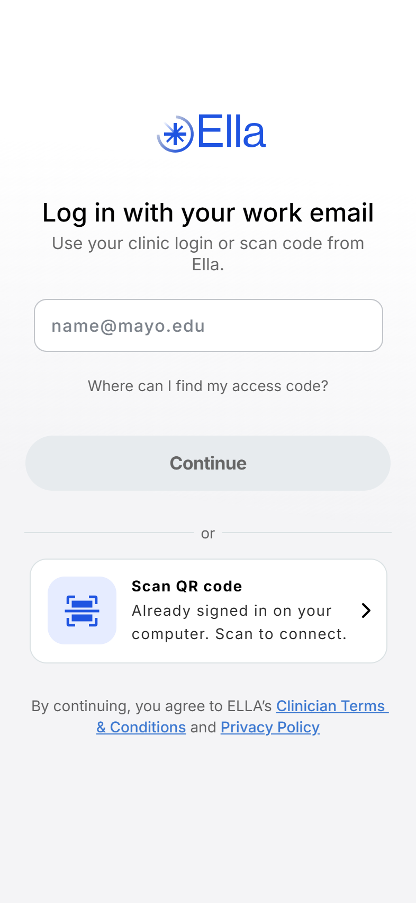
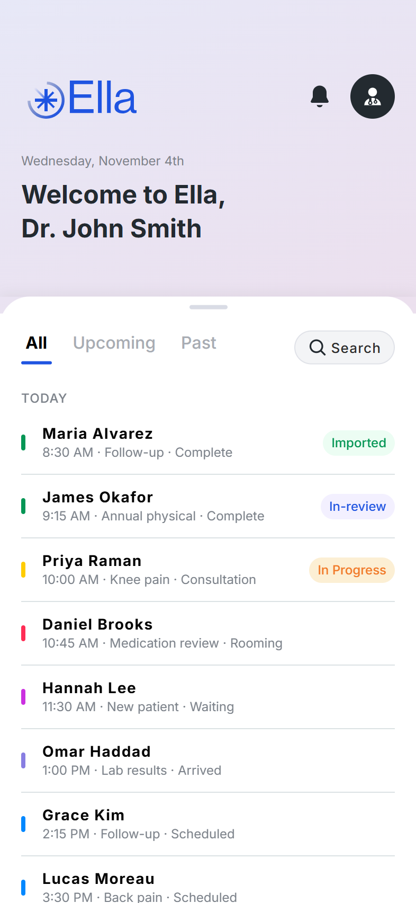
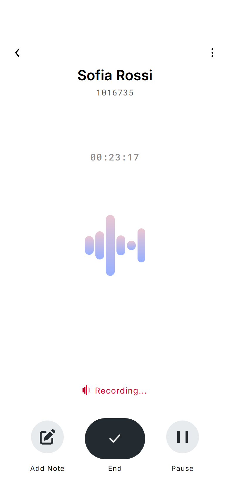
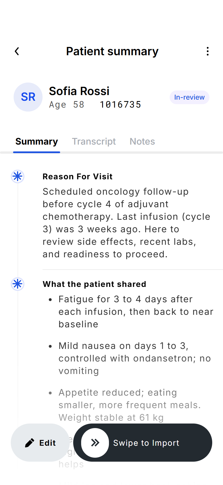
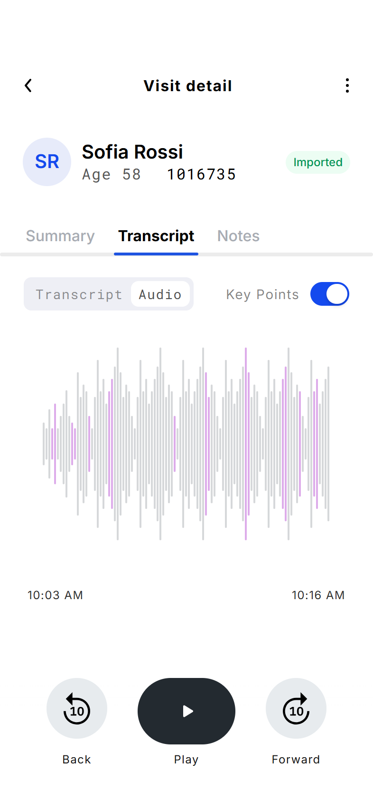

# Ella: an AI note-taker for doctors

Ella is a mobile app design that listens to a doctor's appointment, with the patient's permission, and writes the visit notes. The doctor spends the visit talking to the patient instead of typing.

### 👉 [Try the live preview](https://kartikpd19.github.io/ella-mobile/preview.html?screen=home&state=list#both)

It runs in your browser, so there's nothing to install. Use the **Screen** menu at the top to jump to any screen. On a phone, open **[the app directly](https://kartikpd19.github.io/ella-mobile/)**.

<p>
  
  
  
  
  
</p>

## How it works

1. **Sign in** with a work email, or scan a QR code from the desktop app.
2. **See today's patients.** Each visit shows its time, reason and note status.
3. **Ask for consent.** The doctor reads a short script to the patient. Ella listens for a spoken "yes" or lets the doctor confirm by hand. Nothing is recorded until the patient agrees.
4. **Record the visit.** A live sound visual shows Ella is listening. The doctor can pause or add a quick note at any point.
5. **Get the summary.** Ella writes it section by section: reason for visit, what the patient shared, assessment, medications and follow-up.
6. **Review and import.** The doctor edits the summary if needed, then swipes to send it to the patient's record. The transcript and audio stay with the visit, and key moments are highlighted.

## Try it yourself

In the preview, the login takes any email ending in `@mayo.edu`, such as `john.smith@mayo.edu`, and the one-time code is **`123456`**.

> **Note:** This is a design prototype. There's no real backend, login or AI yet. All patients, summaries and transcripts are made-up sample data, and the browser preview simulates the microphone.

## Built with

- [Expo](https://expo.dev) and React Native, so one codebase runs on iPhone, Android and the web
- TypeScript and Expo Router
- Designed in Figma. The design tokens are in [design.md](design.md)

## Run it on your computer

You need [Node.js](https://nodejs.org) installed.

```bash
npm install
npx expo start
```

Then open http://localhost:8081/preview.html for the phone and tablet preview. To see it on your own phone, scan the QR code that `npx expo start` prints using the [Expo Go](https://expo.dev/go) app.

Every push to `main` updates the live preview automatically through GitHub Pages.
